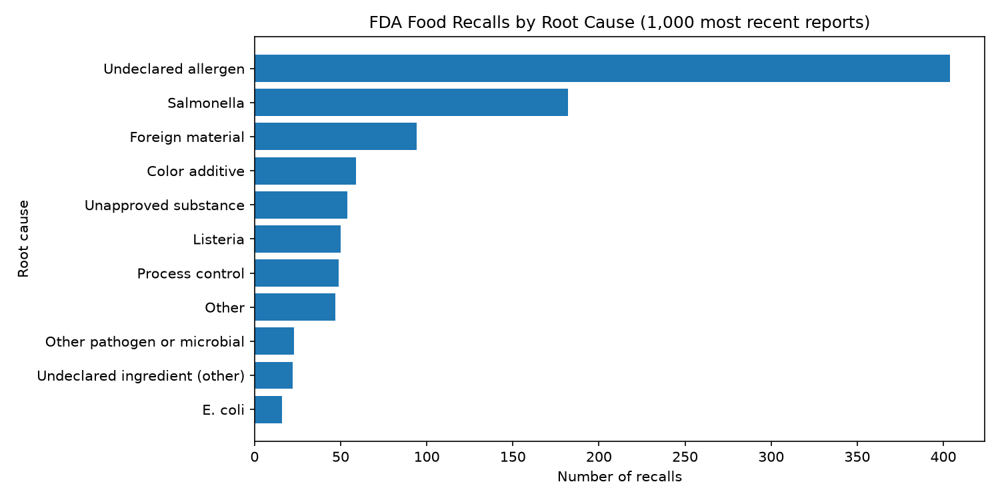

# nlp-01-getting-started

[](pyproject.toml)
[](https://github.com/AbdelhafidhMahouel/nlp-01-getting-started/actions/workflows/ci-python-zensical.yml)
[](https://abdelhafidhmahouel.github.io/nlp-01-getting-started/)

[](https://docs.astral.sh/uv/)
[](https://docs.astral.sh/ty/)
[](https://zensical.org/)
[](LICENSE)

> Retrieve, process, and analyze text from the web using Python,
> applied to U.S. FDA food recall reasons.

## Project Overview

Author: Abdelhafidh Mahouel

Date: 2026 November

First project in the Web Mining and Applied NLP course.

The project has three parts:

1. **Example:** word frequencies on the Wikipedia article on
   Natural Language Processing (`web_words.py`).
2. **Modification (D2):** text cleaning moved into a reusable, tested
   `clean_tokens()` function that uses a regex and removes stop words.
3. **Custom project (D3):** analyze the 1,000 most recent FDA food recalls
   to answer: **what is driving U.S. food recalls, and which causes are
   the most serious?** (`fda_recalls.py`)

The project is configured in
[pyproject.toml](pyproject.toml).

## Data

**Example:** HTML from the Wikipedia article on
[Natural Language Processing](https://en.wikipedia.org/wiki/Natural_language_processing),
retrieved with Requests and parsed with BeautifulSoup.

**Custom project:** JSON from the
[openFDA Food Enforcement API](https://open.fda.gov/apis/food/enforcement/)
(public domain, no API key needed). Each record is one recalled product,
with a free-text `reason_for_recall` and a `classification`
(Class I is the most serious).

No local input dataset is required.

## Approach

The project demonstrates:

- Retrieving HTML from web pages and JSON from web APIs with Requests.
- Parsing HTML and extracting text with BeautifulSoup.
- Cleaning text with a reusable, tested `clean_tokens()` function.
- Grouping free-text recall reasons into root causes with transparent
  keyword rules.
- Counting, grouping, and severity statistics with Polars.
- Visualizing results with Matplotlib bar charts and word clouds.

Explore these important project components:

- [pyproject.toml](pyproject.toml) - project identity, dependencies, and tool configuration.
- [src/nlp/web_words.py](src/nlp/web_words.py) - example analysis of a Wikipedia page.
- [src/nlp/text_cleaning.py](src/nlp/text_cleaning.py) - reusable text cleaning (D2).
- [src/nlp/recall_rules.py](src/nlp/recall_rules.py) - root-cause rules for recall reasons (D3).
- [src/nlp/fda_recalls.py](src/nlp/fda_recalls.py) - custom FDA recall analysis (D3).
- [notebooks/web_words.ipynb](notebooks/web_words.ipynb) - interactive Jupyter notebook example.
- [tests/](tests/) - automated tests.
- [.github/workflows/](.github/workflows/) - automated testing and documentation deployment.
- [docs/](docs/) - project documentation and report.
- [zensical.toml](zensical.toml) - documentation configuration.

## Run the Project

Follow the [Professional Python Workflow Guide](https://denisecase.github.io/pro-analytics-02/)
to set up your machine and project environment.

From a VS Code terminal in the project root:

Run the custom FDA food recall analysis:

```shell
uv run python -m nlp.fda_recalls
```

Run the original example:

```shell
uv run python -m nlp.web_words
```

Close each visualization window after viewing
so the script can continue executing.
The FDA script also saves its charts to `docs/images/`.

## Results

Successful execution produces:

```shell
========================
Pipeline executed successfully!
========================
```

A `project.log` file is created in the project root.

**Key findings (1,000 most recent FDA food recalls, Feb to Oct 2026):**

- **Undeclared allergens cause the most recalls** (404, about 40%).
- **Pathogens cause the most serious recalls:** Salmonella (95.6% Class I),
  Listeria (90.0%), and E. coli (81.2%).
- **Foreign material is common but never Class I** (94 recalls, 0%).



See the [hosted documentation site](https://abdelhafidhmahouel.github.io/nlp-01-getting-started/)
for the full report, including the D2 experiment, the results table,
interpretation, and limitations.

## Verification

Run the automated tests (20 tests for text cleaning and recall rules):

```shell
uv run python -m pytest
```

## Project Documentation

The [hosted documentation site](https://abdelhafidhmahouel.github.io/nlp-01-getting-started/)
is published using Zensical and GitHub Pages.

The documentation site presents the project report,
covering data, methods, results, visualizations,
interpretation, and conclusions.

## CI/CD and GitHub Actions

This project includes continuous integration and continuous deployment (CI/CD)
to check project files and publish the docs.

GitHub Actions include:

- [CI: Python and Documentation Checks](https://github.com/AbdelhafidhMahouel/nlp-01-getting-started/actions/workflows/ci-python-zensical.yml)
- [CD: Documentation Deployment](https://github.com/AbdelhafidhMahouel/nlp-01-getting-started/actions/workflows/deploy-zensical.yml)

## Developer Reference

Follow the
[Professional Python Workflow Guide](https://denisecase.github.io/pro-analytics-02/)
for **detailed instructions and troubleshooting**.

### Initialize and Update the Python Environment

With the project open in VS Code, open a VS Code terminal.
Paste each command and hit Enter or Return after to run it.

```shell
uvx pup-clean --delete
uv self update
uv python pin 3.14
uv python install
uv lock --upgrade
uv sync
uv audit
```

### Set Up and Run Git Hooks

Set up and run the git hooks to perform
basic checks automatically before
any changes get pushed to GitHub.

In the VS Code terminal,
paste each command and hit Enter or Return after to run it.

```shell
uvx prek install --force
uvx prek update --freeze --cooldown-days 7

git add -A
uvx prek run --all-files
# repeat if changes were made
uvx prek run --all-files
```

### Run Common Chores

Run linters, formatters, type checks, tests, and
build the documentation.

```shell
uv run ruff check . --fix
uv run ruff format .

uv run ty check
uv run python -m pytest
uv run python -m zensical build
```

### Git add-commit-push to GitHub

After making useful changes, save your work to GitHub.

```shell
git add -A
git commit -m "describe your changes in quotes"
git push -u origin main
```

## Developer Notes

- Use the **UP ARROW** and **DOWN ARROW** in the terminal to scroll through past commands.
- Use `CTRL+f` to find (and replace) text within a file.

## Developer Tools

This project uses professional Python tools to support development,
testing, documentation, and code quality.

- [uv](https://docs.astral.sh/uv/) - Python environments and dependencies.
- [Ruff](https://docs.astral.sh/ruff/) - Python linting and formatting, configured in [.ruff.toml](.ruff.toml).
- [ty](https://docs.astral.sh/ty/) - Python type checking.
- [pytest](https://docs.pytest.org/) - automated Python testing, configured in [.pytest.toml](.pytest.toml).
- [prek](https://prek.j178.dev/) - Git hooks and automated checks, configured in [prek.toml](prek.toml).
- [Zensical](https://zensical.org/) - project documentation, configured in [zensical.toml](zensical.toml).

## Links

- [Hosted Documentation](https://abdelhafidhmahouel.github.io/nlp-01-getting-started/)
- [Original Example Project](https://github.com/denisecase/nlp-01-getting-started)
- [Professional Python Workflow Guide](https://denisecase.github.io/pro-analytics-02/)
- [openFDA Food Enforcement API](https://open.fda.gov/apis/food/enforcement/)
- [Citation](CITATION.cff)
- [License](LICENSE)
