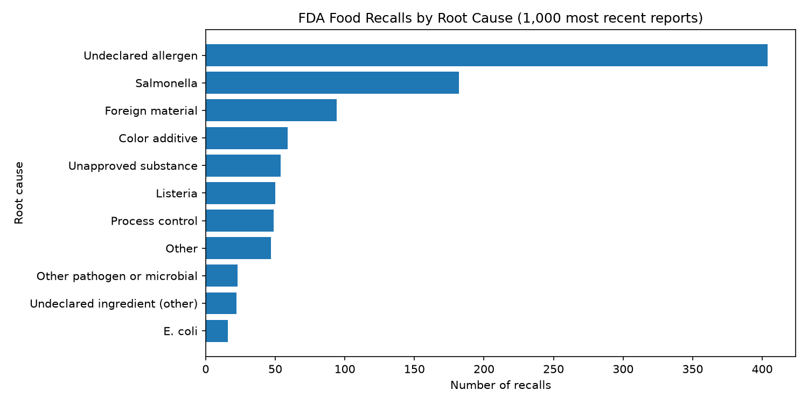
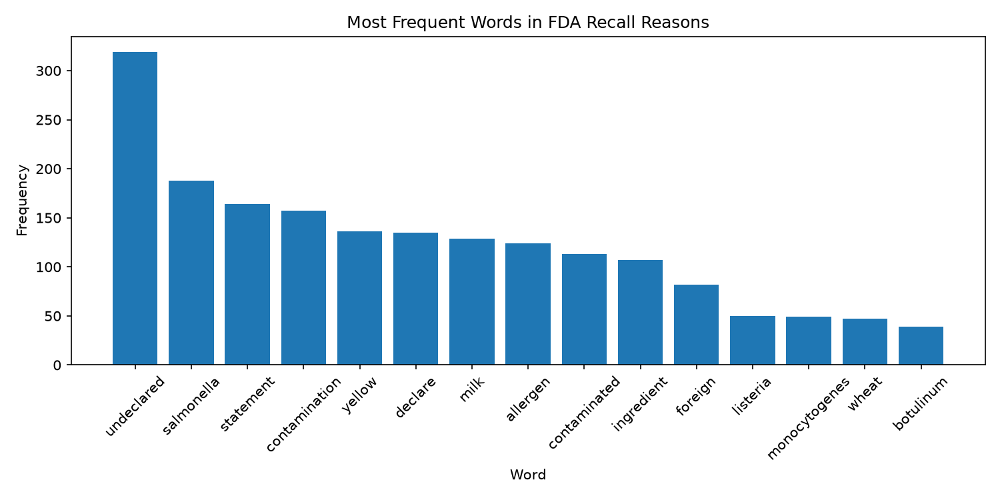
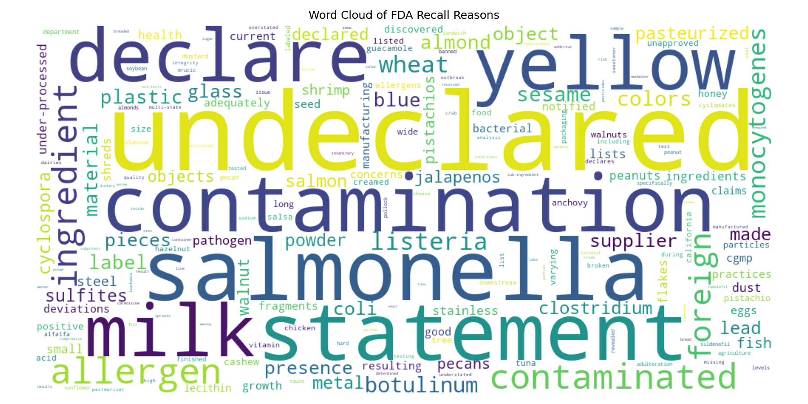

# Web Mining and Applied NLP Project Report

Web Mining and Applied NLP | Project 01 | Abdelhafidh Mahouel

## Overview

This project establishes a professional Python environment
for acquiring and analyzing text from the web.

It starts from the course example (word frequencies on a Wikipedia page),
improves the text cleaning (D2), and then applies the same tools
to a real food manufacturing problem (D3):
**what is driving U.S. food recalls?**

## Tools and Methods

The project uses:

- Python for text acquisition and analysis.
- Requests for retrieving HTML from web pages and JSON from web APIs.
- BeautifulSoup for parsing HTML and extracting text.
- A reusable, tested `clean_tokens()` function (regex and stop words).
- Keyword rules (`recall_rules.py`) to group recall reasons into root causes.
- Polars for counting, grouping, and severity statistics.
- Matplotlib for bar charts.
- WordCloud for visual exploration of vocabulary.
- Logging for execution records.
- Ruff, ty, and pytest for code verification (20 automated tests).
- Zensical and GitHub Pages for published documentation.

## Verification

A successful execution displays:

    Pipeline executed successfully!

The scripts record execution details in a project log.

Automated tests verify the text cleaning and the recall cause rules:

    uv run python -m pytest

## Experiment (D2): Better Text Cleaning

**Modification:** Moved text cleaning out of `web_words.py` into a reusable,
tested function, `clean_tokens()` in `src/nlp/text_cleaning.py`.
It uses a regex to find real words (so "e.g" and dates are not counted)
and removes common English stop words. Five pytest tests cover it.

**Why:** In the baseline run, filler words (from, that, with, this)
and the fragment "e.g" were in the top 10, hiding the real topic words.

**Prediction:** The filler words would disappear, the total cleaned word count
would drop, and topic words like "semantics" and "machine" would move up.

**Result:**

- Cleaned words dropped from 5,513 to 4,583.
- No filler words remain in the top 10.
- New top-10 words: linguistics, semantic, statistical, learning, machine.

| Baseline | After modification |
|---|---|
|  |  |

**What I learned:** Cleaning choices change the results a lot.
Some noise remains from the Wikipedia page itself
(for example "edit", "retrieved", "isbn" from menus and references),
which a later step could remove by extracting only the article body.

## Custom Project (D3): What Is Driving U.S. Food Recalls?

### Question

I work in food manufacturing. I wanted to know what is actually causing
food recalls right now: pathogen contamination (Listeria, Salmonella, E. coli),
labeling problems (undeclared allergens), or process failures
(foreign material, under-processing). I also wanted to know which causes
are the most serious, because that shows where a plant's food safety
and quality efforts matter most.

### Data

- Source: [openFDA Food Enforcement API](https://open.fda.gov/apis/food/enforcement/)
  (public domain, no API key needed).
- The 1,000 most recent food recall reports, dated February 11 to October 28, 2026.
- Fields used: `reason_for_recall` (free text), `classification`
  (Class I, II, or III), `report_date`, and `recall_number`.
- Class I is the most serious: a reasonable chance of serious health
  consequences or death.

### Process

1. Download the recall records as JSON with Requests.
2. Build a Polars table and label each recall reason with a root cause,
   using transparent keyword rules in `src/nlp/recall_rules.py`
   (first matching rule wins, most serious causes checked first).
3. Count recalls by cause and compute the share of Class I recalls per cause.
4. Clean the recall text with the D2 `clean_tokens()` function plus
   recall-specific stop words, and count the most frequent words.
5. Save the charts to `docs/images` automatically.

**Iteration:** The first version of the rules left 27% of recalls as "Other"
and counted undeclared color additives (like FD&C Yellow No. 5) as allergens,
because both reasons say "undeclared". I reviewed the results, matched
allergens by the actual major food allergens, and added categories for
color additives, unapproved substances, and other undeclared ingredients.
"Other" dropped from 266 recalls to 47 (under 5%).
Fourteen pytest tests check the rules.

### Results

| Root cause | Recalls | Class I (most serious) |
|---|---:|---:|
| Undeclared allergen | 404 | 21.5% |
| Salmonella | 182 | 95.6% |
| Foreign material | 94 | 0.0% |
| Color additive | 59 | 1.7% |
| Unapproved substance | 54 | 16.7% |
| Listeria | 50 | 90.0% |
| Process control | 49 | 6.1% |
| Other | 47 | 8.5% |
| Other pathogen or microbial | 23 | 95.7% |
| Undeclared ingredient (other) | 22 | 4.5% |
| E. coli | 16 | 81.2% |

### Interpretation

- **Allergen labeling causes the most recalls.** About 40% of recalls
  are undeclared allergens, with milk by far the most frequent allergen word, followed by wheat and sesame.
  This is mostly a labeling and changeover problem, not a contamination problem.
- **Pathogens cause the most serious recalls.** Over 80% of Salmonella,
  Listeria, E. coli, and other pathogen recalls are Class I.
- **Foreign material is common but rarely serious.** It caused 94 recalls,
  but none were Class I.

For a food plant, this suggests two different priorities:
label review and allergen changeover controls prevent the **most** recalls,
while sanitation and pathogen controls prevent the most **harm**.

### Limitations

- Only the 1,000 most recent reports (about 8 months) are included.
- Keyword rules are simple. A reason that mentions two hazards is counted
  once, under the first matching rule.
- One recall event can include many products, so counts reflect recalled
  products, not separate incidents.
- About 5% of reasons remain "Other" (spoilage, packaging defects,
  nutrient levels, mislabeled products).

### Next Steps

- Pull more history (the API allows paging) to look at trends over time.
- Count recall events instead of products to avoid double counting.
- Break down allergen recalls by specific allergen.

## Interpretation (Example Project)

Web text contains both useful information and noise
introduced by document structure and formatting.

Simple text cleaning and frequency analysis
provide an initial view of a document's vocabulary.

These techniques establish a foundation
for later work involving text preprocessing,
corpus exploration, and natural language processing.

## Documentation Index

- **Home** - this landing page
- [**Project Instructions**](project-instructions.md)
- [**Glossary**](glossary.md)

## Project Links

- [GitHub Repository](https://github.com/AbdelhafidhMahouel/nlp-01-getting-started)
- [FDA Recalls Script](https://github.com/AbdelhafidhMahouel/nlp-01-getting-started/blob/main/src/nlp/fda_recalls.py)
- [Recall Rules Module](https://github.com/AbdelhafidhMahouel/nlp-01-getting-started/blob/main/src/nlp/recall_rules.py)
- [Text Cleaning Module](https://github.com/AbdelhafidhMahouel/nlp-01-getting-started/blob/main/src/nlp/text_cleaning.py)
- [Example Script](https://github.com/AbdelhafidhMahouel/nlp-01-getting-started/blob/main/src/nlp/web_words.py)
- [Example Notebook](https://github.com/AbdelhafidhMahouel/nlp-01-getting-started/blob/main/notebooks/web_words.ipynb)
- [Original Example Project](https://github.com/denisecase/nlp-01-getting-started)
- [openFDA Food Enforcement API](https://open.fda.gov/apis/food/enforcement/)

## Project Resources

- [Project Instructions](project-instructions.md)
- [Professional Python Guide](https://denisecase.github.io/pro-analytics-02/)
- [Professional Python Project Explainer](https://pup-pack.github.io/professional-python-project-explainer/)
